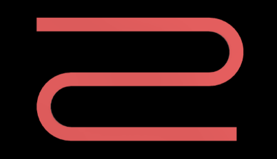

<div align="center">


<br><br>



# 🔴 ViraCode

### Autonomous Development Platform & Virtual Runtime

<p>
A modern development platform designed for fast, intelligent, and seamless software creation.
</p>

<p>
Build faster. Create smarter. Code beyond limits.
</p>

<br>


<br><br>

<a href="https://viracode.ai.studio">
  
</a>

</div>

---

# ⚫ About

ViraCode is an autonomous development platform built for developers, creators, and innovators.

Combining an intelligent coding environment with a powerful virtual runtime, ViraCode helps streamline development workflows while providing a modern and flexible workspace.

Whether you're building web applications, tools, automation systems, or experimental projects, ViraCode provides everything you need in a single environment.

---

# 🔴 AI-Native Experience

ViraCode is designed around modern AI workflows.

From rapid prototyping to project management and production-ready development, the platform enables developers to move from idea to implementation faster than ever before.

---

# ⚫ Virtual Runtime

Run, test, and manage projects within a dedicated virtual environment designed to support modern development workflows.

Built to be lightweight, scalable, and developer-friendly.

---

# 🔴 Built with AI Studio

<p align="center">


</p>

### The fastest path from prompt to production.

Powered by modern AI technologies and developed using AI Studio.

🔗 https://aistudio.google.com/apps

---

# ⚫ Platform

```text
ViraCode
├── AI Development
├── Virtual Runtime
├── Modern Workspace
├── Project Management
└── Developer Ecosystem
```

---

# 🔴 Official Website

https://viracode.ai.studio

---

<div align="center">

━━━━━━━━━━━━━━━━━━━━━━━━━━━━━━━━━━━━━━━━━━━━━━━━━━

# 🔴 ViraCode

### CODE BEYOND LIMITS

Built by ViraBot Programming

━━━━━━━━━━━━━━━━━━━━━━━━━━━━━━━━━━━━━━━━━━━━━━━━━━

</div>
